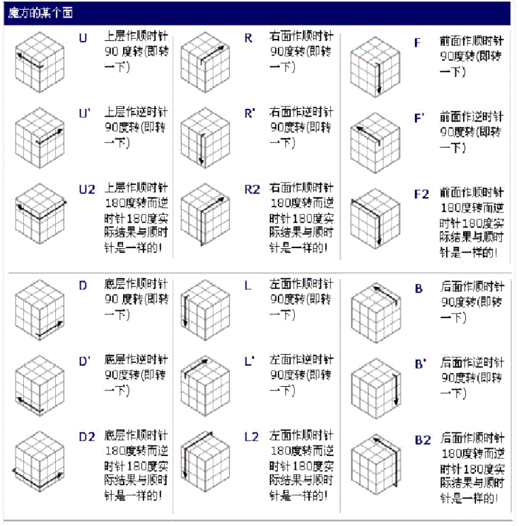

# 魔方机器人

视频材料请点击链接：【24年魔方机器人竞赛国家级二等奖视频记录-哔哩哔哩】 https://b23.tv/V3nBytA

包含了国奖证明、比赛合影和魔方还原测试与实操，最终以7s的识别+解算+成功还原斩获国家级二等奖，总排名9/55。

一套使用四路视觉识别、Two-Phase 魔方求解和双臂协同执行的实体魔方机器人程序。
该系统已完成从图像采集、状态识别、公式求解、机械动作优化到 ODrive/Arduino 执行的完整流程，
当前仓库以 2024 年更新的“按键夹”版本作为正式版本。

> **安全警告**：程序会在初始化时进行 ODrive 编码器索引搜索，并驱动双臂、夹爪和电磁/气动机构。
> 首次部署必须空载、限速并配备可触及的硬件急停。不要仅依赖终端中断保证安全。



## 工作流程

1. 四路摄像头同时采集魔方六个面。
2. OpenCV 根据固定采样点和颜色阈值生成 54 位状态字符串。
3. `RubikTwoPhase` 计算复原公式。
4. 机械代价算法重排动作并转换为左右腕、左右夹爪指令。
5. ODrive 控制双腕，Arduino 控制夹爪和辅助执行机构。

详细调用关系见 [系统架构](docs/architecture.md)，接线与首次上机检查见
[硬件部署](docs/hardware.md)。

## 目录结构

```text
.
├── src/                    # 当前正式 Python 程序
├── firmware/               # Arduino 正式固件和旧硬件固件
├── config/
│   ├── runtime.env.example # 运行设备配置示例
│   └── odrive/             # 比赛期间保存的 ODrive 参数快照
├── tools/                  # 视觉标点和硬件诊断脚本
├── docs/                   # 架构、硬件和坐标说明
├── legacy/                 # 自动夹旧版本和实验代码
└── requirements.txt        # Python 依赖
```

原项目中的 IDE 文件、字节码、运行截图、压缩备份和重复求解表已移出 Git 管理范围。
Two-Phase 数据由 `RubikTwoPhase` 在安装/首次运行时提供或生成，不再在多个目录重复提交。

## 环境要求

- Linux（程序使用 `/dev/ttyUSB*` 和 `/dev/video*` 设备）
- Python 3.7.x（比赛环境为 3.7.1）
- ODrive Python API `0.5.1.post0`
- Arduino CLI 或 Arduino IDE
- 四路 UVC 摄像头和可用图形桌面（程序会调用 `cv2.imshow`）

## 安装

```bash
python3.7 -m venv .venv
source .venv/bin/activate
python -m pip install --upgrade pip
python -m pip install -r requirements.txt
```

`RubikTwoPhase` 首次导入可能生成较大的剪枝表，并耗时约半小时或更久；应在比赛运行前完成一次预热。

## 设备配置

先查看设备，再按实际路径导出配置：

```bash
ls -l /dev/ttyUSB* /dev/video*
cp config/runtime.env.example .env
# 编辑 .env 后加载；程序不会自动读取该文件
source .env
```

可配置项包括 Arduino 串口、波特率、ODrive 序列号及四路相机路径。若不设置，程序使用
`/dev/ttyUSB0`、`115200` 和 `/dev/video2,4,6,8`。

## 运行

上机前先完成 [首次上机检查](docs/hardware.md#首次上机检查)，并核对 Arduino 固件协议。

```bash
source .venv/bin/activate
source .env
python src/main.py
```

操作顺序：

1. 启动后等待 ODrive 连接和双轴标定完成。
2. 放入魔方，用手合拢双爪；此时遮住色块，避免提前触发识别。
3. 确认人员离开运动范围后按 Enter。
4. 移开遮挡，程序识别魔方并自动执行复原。
5. 按终端提示确认，释放夹爪并结束流程。

## 软件侧检查

不连接硬件时不要运行 `src/main.py`。可执行语法检查：

```bash
python -m compileall -q src tools
```

纯求解器预热/检查：

```bash
python -c "import twophase.solver as s; print(s.solve('UUUUUUUUURRRRRRRRRFFFFFFFFFDDDDDDDDDLLLLLLLLLBBBBBBBBB', 0, 1))"
```

## 二次开发

- 调整相机或光照：重新标定 `src/vision_.py` 中的采样坐标和 BGR 阈值。
- 调整机械速度：先备份 ODrive 参数，再修改 `src/hardware.py` 的加速度、速度增益和标定角。
- 修改串口协议：必须同步修改 `src/hardware.py` 与 Arduino 固件，并逐条台架验证。
- 正式入口只维护 `src/`；`legacy/` 不应直接复制回正式流程。

## 开源说明

仓库暂未添加许可证。在选择并添加 `LICENSE` 前，默认保留全部权利；公开到 GitHub 后，
其他人可以阅读代码，但不能据此推定获得复制、修改或再分发授权。
